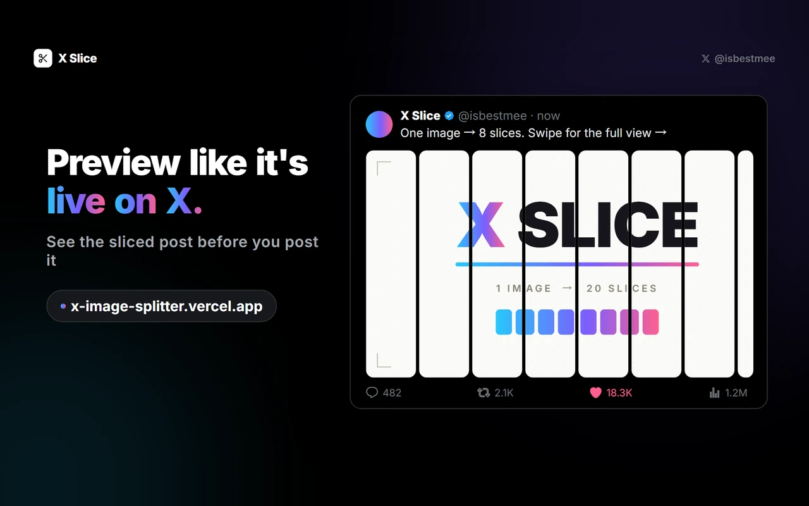
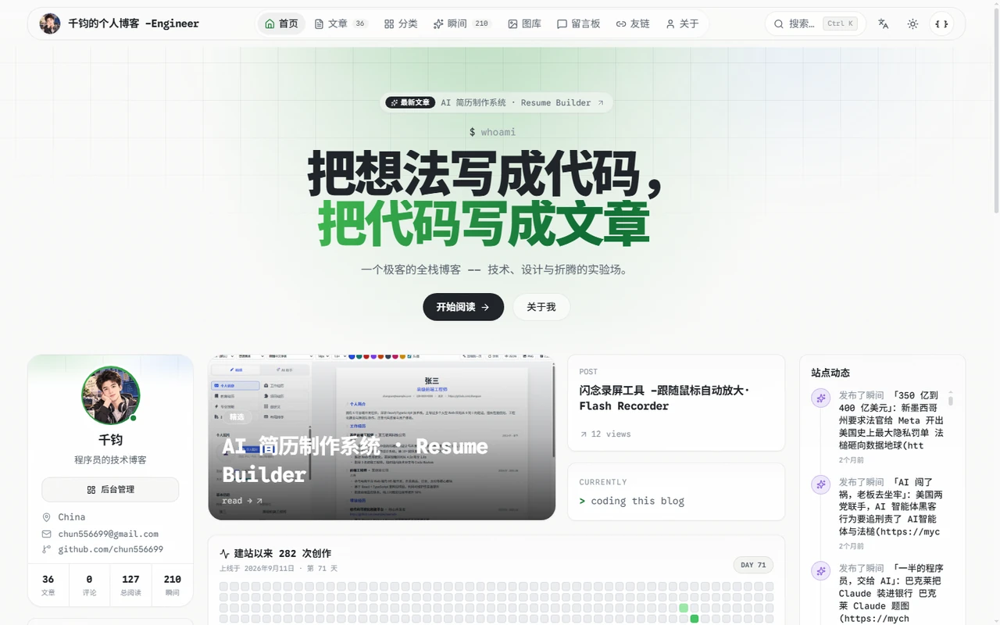
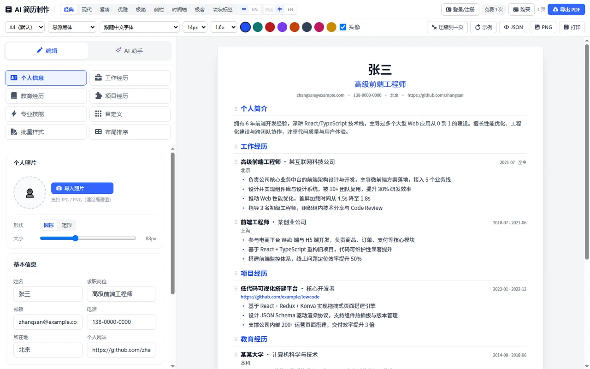
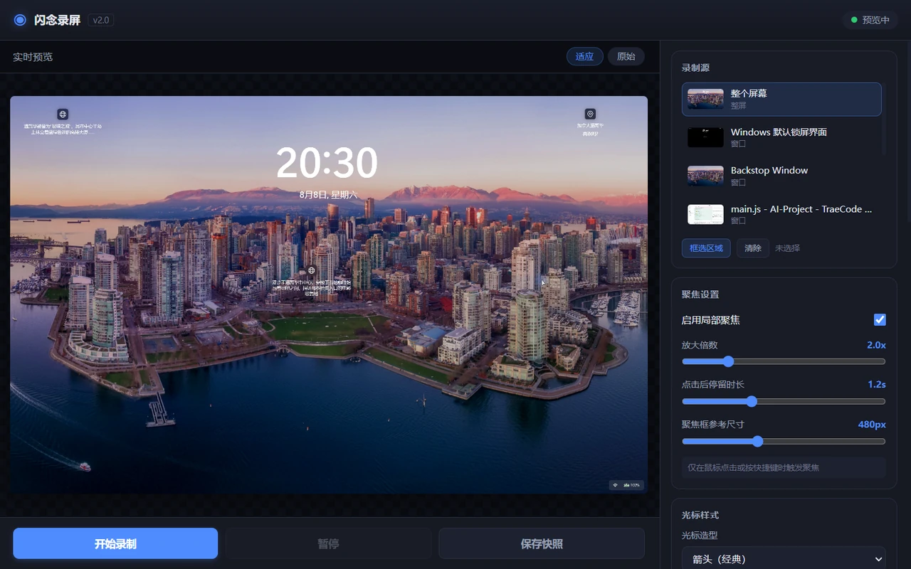

<table width="100%">
  <tr>
    <td valign="middle">
      <a href="https://x.com/isokchun" title="X (@isokchun)"><picture><source media="(prefers-color-scheme: dark)" srcset="https://cdn.simpleicons.org/x/ffffff"></picture></a>
      <a href="mailto:chun556699@gmail.com" title="Email (chun556699@gmail.com)"><picture><source media="(prefers-color-scheme: dark)" srcset="https://raw.githubusercontent.com/Chun556699/Chun556699/main/assets/mail-dark.svg"></picture></a>
      <a href="https://www.mychun.cn" title="Blog (mychun.cn)"><picture><source media="(prefers-color-scheme: dark)" srcset="https://raw.githubusercontent.com/Chun556699/Chun556699/main/assets/globe-dark.svg"></picture></a>
      <a href="https://www.mychun.cn" title="Chun · 千钧"><picture><source media="(prefers-color-scheme: dark)" srcset="https://raw.githubusercontent.com/Chun556699/Chun556699/main/assets/cf-dark.svg"></picture></a> <b>Hi, I'm Chun · 你好，我是千钧 👋</b> 
      AI Systems &amp; Full-Stack Builder · 专注 AI 应用工程、桌面工具与全栈产品化
    </td>
  </tr>
  <tr>
    <td align="center">
      
      
       
      
      
    </td>
  </tr>
  <tr>
    <td>
      <b>languages · 编程语言</b> 
      
      
      
      
      
    </td>
  </tr>
  <tr>
    <td>
      <b>frontend &amp; desktop · 前端与桌面</b> 
      
      
      
      
      
      
    </td>
  </tr>
  <tr>
    <td>
      <b>agents / ai · 智能体与模型</b> 
      
      
      
      
      
      
      
      
      
      
    </td>
  </tr>
  <tr>
    <td>
      <b>infra · 后端与基建</b> 
      
      
      
      
      
      
      
      
    </td>
  </tr>
</table>
